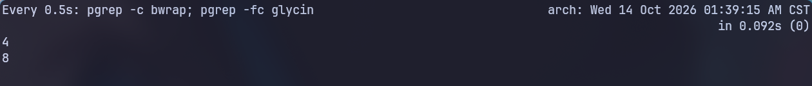
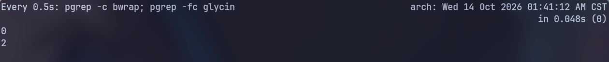
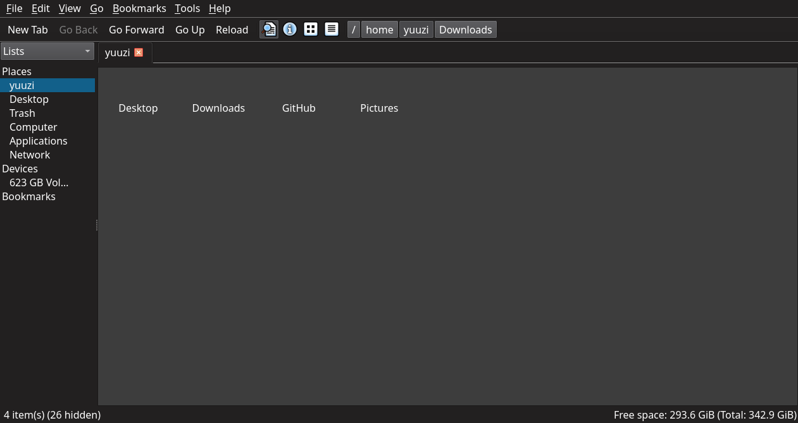
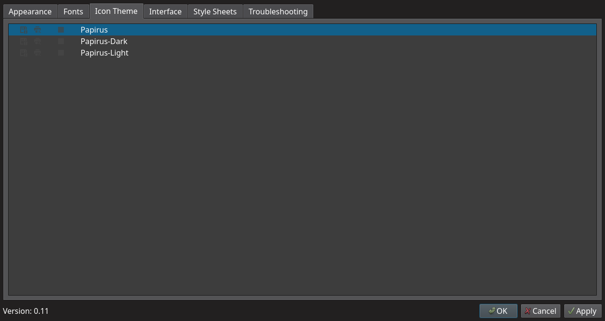
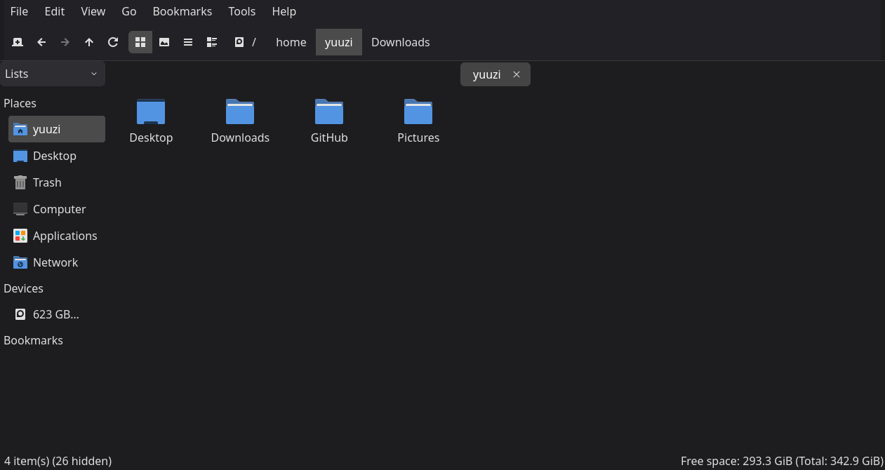
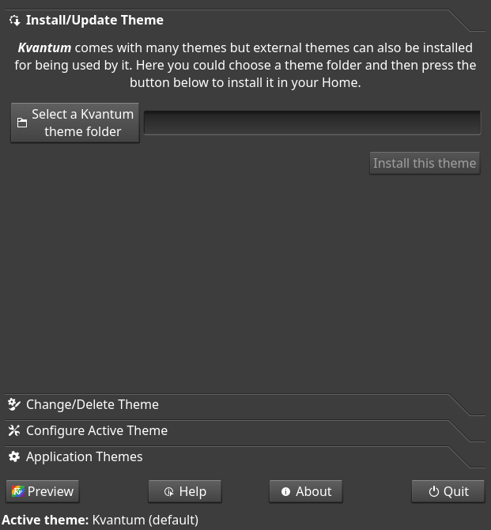
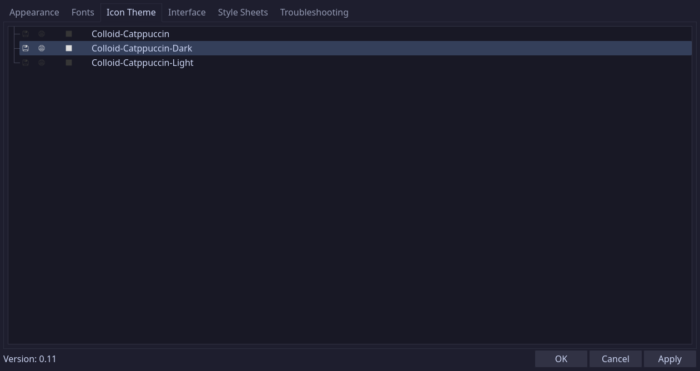
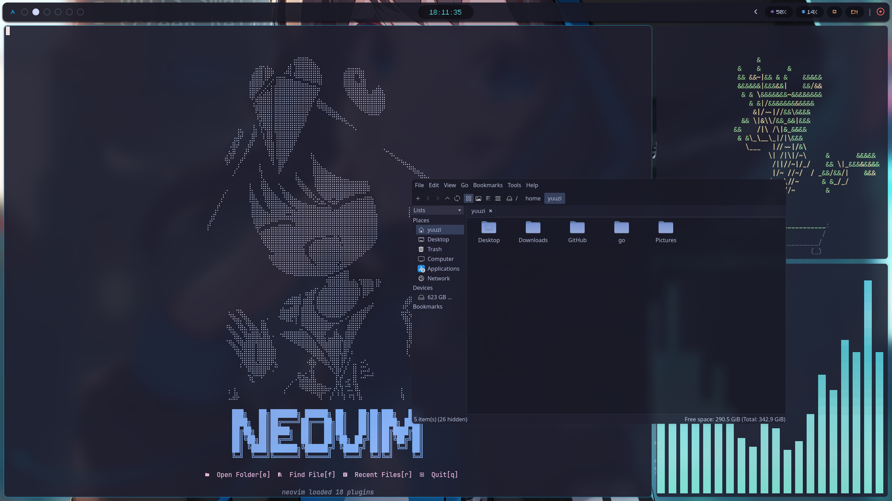

# 前言

選用 ArchLinux + Hyprland 的原因之一就是想要客製化又流暢的桌面體驗，但就敗在長期使用 WSL 的緣故，對 Linux 的 GUI 生態熟悉度並不是很足夠，雖然 [Yazi](https://github.com/sxyazi/yazi) 已經非常實用又快到起飛了，但還是希望有個輕量的 GUI 檔案管理器可以在需要的時候支援一下，上網查了一下感覺 [Nemo](https://github.com/linuxmint/nemo) 很符合我的需求，結果實際使用後發現在 Arch Linux 上冷啟動時並不流暢，但又不像某些文章提到的坑卡到一個很不合理的延遲這樣（比如網路上最常見的某個 D-Bus 呼叫卡到 timeout，預設會拖約 25 秒），只是第一次啟動都會小頓一下而已...

**<font style="font-size: 1.5rem">但不影響使用不代表不影響心情啊コラ！！</font>**

於是我開始找找看有沒有好方法解決這個問題～

# 權宜之計

首先第一個方法就是「不要冷啟動」！沒錯，既然冷啟動很慢，那不要冷啟動就好啦(ゝ∀･)⌒☆

所以我在 Hyprland 設定檔中加上一行：

```lua title="hyprland.lua" ins={3}
hl.on("hyprland.start", function ()
...
hl.exec_cmd("[workspace special:files silent] nemo --no-desktop")
...
end)
```

這樣一來啟動的時候就會先把 Nemo 實例開起來丟到一個 Hyprland 的特殊工作區，等於先偷偷暖好機了，由於 Nemo 是單例的，之後只要不要手動把所有 Nemo 視窗都 kill 掉，無論你想開幾個在任意工作區，就都是熱啟動了，非常流暢。

不過顯然我對此還不滿意，不然就不會有今天這篇文章了，居然要一直開著一個用不到的視窗掛著，而且還不能無頭模式，非得要那個視窗開在那裡，這是對我的精神潔癖莫大的考驗(╯°Д°)╯ ┻━┻。

其實無頭的話 Nemo 有個參數: `--no-default-window`，一開始我對它寄予厚望，只是實際測試後發現沒視窗的話還是會自己死掉，它沒有提供真正的 daemon 模式：

```sh
nemo --no-default-window
```

不太確定我有沒有誤會這個參數的用法或是問題的根本原因，總之測試了一下後宣告失敗。我決定找出問題的源頭看看能不能解決，不能的話就看看有沒有適合的替代品，反正我的追求就是一個輕量、啟動快、功能大致完善的檔案管理工具而已，沒有說一定非 Nemo 不可。

# 查找問題

## 冷啟動測量

首先我先用 `time` 量冷啟動的時間：

```sh
time nemo ~
```

輸出結果如下：

```log "1.10s user" "99% cpu"
(nemo:318018): Nemo-WARNING **: 05:20:09.145: Current gtk theme is not known to have nemo support (Adwaita) - checking...
(nemo:318018): Nemo-WARNING **: 05:20:09.213: The theme appears to have no nemo support.  Adding some...
(nemo:318018): Nemo-WARNING **: 05:20:09.235: Action 'mount-archive.nemo_action' is missing dependency: gnome-disk-image-mounter
nemo ~  1.10s user 0.72s system 99% cpu 1.834 total
```

上面三個警告雖然顯眼但對啟動速度影響沒這麼大，重點是最下面一行的 `1.10s user`、`99% cpu` 等關鍵字，這代表冷啟動期間，Nemo 不是在等待什麼東西而拖延到了啟動，而是這卡頓的一小段時間，CPU 在忙著在算什麼東西導致了延遲。

## 找戰犯時間

為了搞清楚具體來說 CPU 到底在算什麼，我找來了 [perf](https://archlinux.org/packages/extra/x86_64/perf/) 幫忙，它是 Linux 核心的效能分析與稽核工具，屬於 `linux-tools` 的一部分，由於在 Arch 官方的 `extra` 軟體庫，所以可以直接使用 `pacman` 安裝：

```sh
sudo pacman -S perf
```

使用 `perf` 對 Nemo 進行測量，看看哪個函式庫在偷吃 CPU：

```sh
nemo -q                                         # 確保 Nemo 全部關閉
perf record -g -o /tmp/nemo.perf -- nemo ~      # 視窗出來後關掉
perf report -i /tmp/nemo.perf --no-children --sort dso --stdio 2>/dev/null | grep -v '^#' | head -25
```

輸出結果如下：

```log
    44.16%  libglycin-2.so.0
        |
        |--8.43%--0x7fc2388fc99c
        |          0x7fc2388fc764
        ...
```

`libglycin` 佔了 44% 的 CPU 時間，所以是圖片載入的底層在卡，不是 Nemo 自己的 code 在搞。

## `glycin` 搞啥？

這東西我要是沒被 Nemo 這樣一搞我大概也不會特別去了解它的作用，查了一下是 Arch Linux 的 `gdk-pixbuf2`（圖片載入函式庫）從 `2.44` 開始採用的，原本的傳統載入器似乎有記憶體安全漏洞而且時常成為惡意程式碼的攻擊點，為了安全改用了 `glycin` 這個以 Rust 編寫的框架，它的原理就是透過 `bwrap` 將每個圖片的解碼器隔離在獨立的沙盒中執行，避免讓解碼器跟呼叫它的應用程式比如說瀏覽器或是 Nemo 本 mo 在同一個 process 下，這樣就比較不怕圖片偷藏病毒。

好的，現在我們有<font style="font-size: 1.5rem"><b>獨立沙盒</b></font>還有<font style="font-size: 1.5rem"><b>IPC</b></font>（跨行程通訊），安全是安全了，但 GTK3 的程式不像 GTK4 的程式會直接調用 `glycin` 以及透過重用沙盒避免頻繁開關，它還在呼叫底層已經改成 `glycin` 的 `gdk-pixbuf2`，如果遇到 Nemo 這種需要讀取一堆小圖示的 GTK3 應用，簡直就是來到地獄，於是就出現了冷啟動都要頓一下的變態情況。

現在我們可以來驗證看看沙盒是不是 Nemo 開的，使用下面這個指令監看：

```sh
watch -n0.5 'pgrep -c bwrap; pgrep -fc glycin'
```

- 開著 Nemo 時（掛著沒進行任何操作）：
    
- 關閉 Nemo 後：
    

可以看到開關前後數量差異頗大。

:::note
實際上關閉 Nemo 後剩下的兩個 `glycin` 是 `watch` 和它底下的 `sh -c`，所以基本上可以說是全部都 Nemo 開的。
:::

## 兩種解法

### 解法一

一個是把 `glycin` 直接一個蛋雕，改用不帶 `glycin` 的 [`gdk-pixbuf2-noglycin`](https://aur.archlinux.org/packages/gdk-pixbuf2-noglycin)，不過就是需要自己 AUR 搞來編譯，並且犧牲掉一定程度上的安全性，然後聽說 SVG 會有一些小問題，還要另外處理這樣：

```sh
# 或是用 paru
yay -S gdk-pixbuf2-noglycin
```

### 解法二

跟 GTK3 說再見，換一個不是 GTK3 的，避免再次踩到雷。

我希望替代品：

- 具有分頁功能
- 啟動快，最好跟 Terminal 一樣秒開
- 輕量，臃腫的軟體都是壞文明
- 外觀容易融入我自訂的 Hyprland Rice
- 如同上面說的，底層不要是 GTK3 這種準老古董

最後我找到了： [<font style="font-size: 1.5rem"><b>PCManFM-Qt</b></font>](https://github.com/lxqt/pcmanfm-qt)

# PCManFM-Qt

這傢伙是 Qt 程式所以沒有上面那些問題，不會經過 `glycin`，而且它有 `--daemon-mode`，可以無頭常駐，唯一的缺點就是預設界面奇醜，所以最後就來稍微講一下怎麼把這東西變好看一點d(`･∀･)b。

這是剛載好打開的畫面，連圖示都沒有笑死：



這是因為如同 GTK 程式從 gsettings 讀圖示主題，Qt 程式則要靠 qt6ct。qt6ct 裡沒選圖示主題時，就會一片空白。另外，現在的圖示主題幾乎都是 SVG，少了 qt6-svg 就算選好主題也畫不出來。

```sh
sudo pacman -S --needed qt6ct qt6-svg
```

另外，需要在 `hyprland.lua` 加上：

```lua title="hyprland.lua"
hl.env("QT_QPA_PLATFORMTHEME", "qt6ct")
```

接下來進到 qt6ct 的 Icon Theme 分頁選擇圖示包，如果沒有的話就去找個喜歡的裝個，下面圖片僅供參考，我後來是用 Colloid 的圖示包，改完記得按 Apply：



## 用 Kvantum 取代 Fusion

Fusion 是 Qt 預設的樣式，但外觀有點陽春了，跟不太上現代的審美，我這裡決定改用 Kvantum 主題引擎，也是為了之後可以使用 [Catppuccin](https://github.com/catppuccin/kvantum) 色彩主題鋪路。Kvantum 也是有在 Arch 官方 `extra` 軟體庫的，直接用 pacman 管理：

```sh
sudo pacman -S kvantum
```

然後在 qt6ct 的 Appearance 分頁把 Style 改成 `kvantum`（暗黑模式的記得選 `kvantum-dark` ）。



現在看起來好上不少了，不過為了融入整體的桌面再套個顏色主題（這個時候我還沒換成上面說的 Colloid 圖示包，這個圖示包也可以設定 Catppuccin 主題色，之後一起搞上。當然，如果你不是用 Catppuccin 的話就找一下自己在用的主題換上）。

## 貓貓啟動 - Catppuccin 化

### Kvantum 部份

AUR 上有 `kvantum-theme-catppuccin-git`，但我實際使用後發現，它會把四種配色乘以十幾種強調色全部裝進來，kvantummanager 的列表長到捲不完。所以後來我選擇用 git 直接拉特定主題下來，看起來會乾淨不少。

```sh
git clone --depth 1 --filter=blob:none --sparse https://github.com/catppuccin/kvantum.git ~/.local/src/catppuccin-kvantum
cd ~/.local/src/catppuccin-kvantum
git sparse-checkout set themes/catppuccin-mocha-blue

mkdir -p ~/.config/Kvantum
cp -r themes/catppuccin-mocha-blue ~/.config/Kvantum/
printf '[General]\ntheme=catppuccin-mocha-blue\n' > ~/.config/Kvantum/kvantum.kvconfig
```

:::note
最後一行指令也可以用 GUI 的 kvantummanager 來操作，從下拉式選單裡面找出想設定的：

:::

這裡也順便解釋一下 git 那一行的參數意義：

| 參數 | 作用 |
| --- | --- | 
| `--depth 1` | 淺層 clone，只拿最新的一個 commit |
| `--filter=blob:none` | 部分 clone，先只下載目錄結構，不下載檔案內容（blob），等真的要用時才抓 |
| `--sparse` | clone 完只在工作目錄放出根目錄的檔案，子資料夾先不展開 | 

### Colloid 部份

接下來就是把 Colloid 套上我的 Catppuccin 強調色，我平常都是用藍色作為強調色。

AUR 上的 `colloid-catppuccin-theme-git` 也有類似問題，而且比 Kvantum 更嚴重一點：

- 它是 split package。 一個 PKGBUILD 要打包原版、Catppuccin、Dracula、Everforest、Gruvbox、Nord 和游標共七個子套件。雖然最後只安裝指定的那一個，但每次都要全部編譯一遍，安裝過程久到吐血。
- Catppuccin 子套件本身就有 27 個資料夾：9 種顏色，每種有 Light、Dark 和基本版。

雖然可以透過設定 pacman 的 `NoExtract` 過濾，不過我後來還是決定用腳本單獨安裝我要的顏色就好：

```sh
git clone --depth 1 https://github.com/vinceliuice/Colloid-icon-theme.git ~/.local/src/Colloid-icon-theme
cd ~/.local/src/Colloid-icon-theme
./install.sh -s catppuccin -t default
```

這樣只會在 `~/.local/share/icons` 產生 `Colloid-Catppuccin`、`-Light`、`-Dark` 三個資料夾，幾秒就跑完了。之後跟上面一樣到 `qt6ct` 裡面去修改：



到這裡就基本完成了，也是能看了許多ヽ(✿ﾟ▽ﾟ)ノ，整體也是非常和諧：



## Hyprland 後續設定

1. 在 hyprland.lua 中設定開機自啟 PCManFM-Qt 背景服務

```lua title="hyprland.lua"
local fileManager = "pcmanfm-qt"

hl.on("hyprland.start", function ()
    ...
    hl.exec_cmd(fileManager .. " --daemon-mode")
end)
```

2. 設為預設的資料夾開啟程式

```sh
xdg-mime default pcmanfm-qt.desktop inode/directory
```

# 結語

這下也是把這個令人有點惱火的問題給解決了，從此不管開 TUI 的 Yazi 還是 GUI 的 PCManFM-Qt 都是幾乎沒有延遲的秒開，這才像話嘛～哪有同樣的硬體 Linux 上開檔案管理器可以比 Windows 上開檔案總管還慢的道理呢(;ﾟ∀ﾟ)

